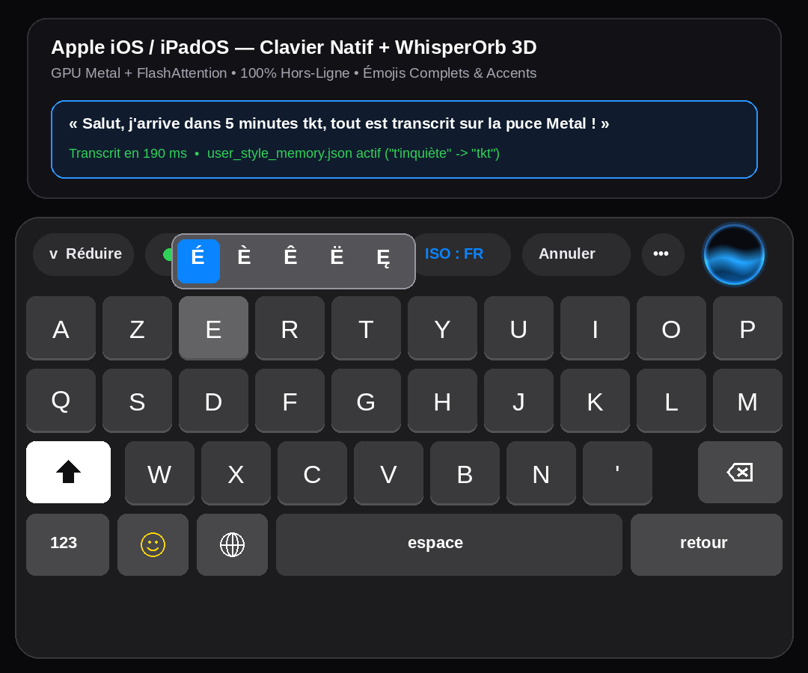
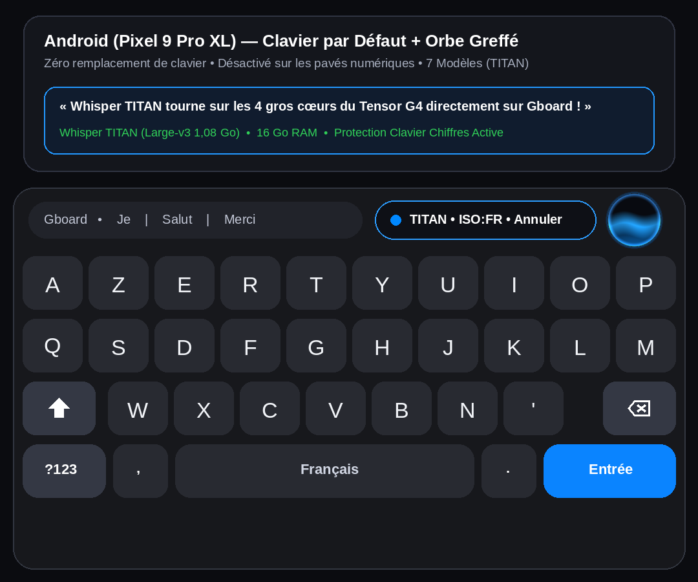

# WhisperOrb `v2.0.0`

**100% On-Device Offline AI Voice Dictation Ecosystem for Apple (iOS / iPadOS / macOS) & Android**

[-white?style=for-the-badge&logo=apple)](https://github.com/bluewolfy24yt/WhisperOrb/releases/latest)
[-3DDC84?style=for-the-badge&logo=android)](https://github.com/bluewolfy24yt/WhisperOrb/releases/latest)

<h3>
  <a href="#-english-documentation">🇬🇧 English Documentation</a>
  &nbsp;&nbsp;•&nbsp;&nbsp;
  <a href="#-documentation-française">🇫🇷 Documentation Française</a>
</h3>

---

## 📸 Visual Showcase — Apple & Android Keyboards with the 3D Orb

| 🍎 **Apple (iOS / iPadOS)** — Native Keyboard + Full Emojis & Accents | 🤖 **Android (Pixel / Samsung / All OEMs)** — Orb Grafted onto Default Keyboard |
| :---: | :---: |
|  |  |

---

# 🇬🇧 English Documentation

## Overview

**WhisperOrb v2.0.0** is a complete, 100% offline, privacy-first voice dictation ecosystem powered by native `whisper.cpp` C++/Metal/ARM64 acceleration. Zero audio ever leaves your device: every transcription runs locally on your phone, tablet, or computer silicon with sub-second latency.

### Key Highlights in `v2.0.0`

1. **🤖 Native Android Integration (No Keyboard Replacement Required)**
   - Keep your favorite default Android keyboard (**Gboard**, Samsung Keyboard, SwiftKey) with all its swipe typing, autocorrect, and clipboard features.
   - WhisperOrb uses a lightweight `AccessibilityService` overlay to dock the **120 Hz 3D Cosmic Black Hole Orb** directly onto the top bar of your default keyboard whenever a text input field is focused.
   - **Numeric Keypad Protection**: Automatically inspects `EditorInfo.inputType` (`TYPE_CLASS_NUMBER`, `TYPE_CLASS_PHONE`, `TYPE_CLASS_DATETIME`). Whenever a number pad, phone dialer, or PIN screen opens, **WhisperOrb immediately hides and touches nothing**.

2. **🍎 1:1 Native Apple iOS/iPadOS Keyboard + Full Emoji Catalog**
   - Built-in dark Apple keyboard (`#1C1C1E`) with instant touch-down key magnifier callouts, long-press + slide horizontal accent selector, **complete 9-category Apple Emoji Picker (`😀`) with persistent Recents**, and a 1-tap **Collapsed Voice Bar (`▾`)** mode.
   - Accelerated by **Apple Metal GPU + FlashAttention** (`whisper.xcframework` `b5454`) and 100% future-proof hardware detection (`MTLCreateSystemDefaultDevice()` supporting all iPhones up to iPhone 18 Pro Max & future Apple Silicon).

3. **🌐 Smart Multilingual Engine (Zero Hardcoded Language)**
   - Automatically detects your device's active system language (`Locale.current` on iOS / `Locale.getDefault().language` on Android) and passes the exact ISO 639-1 code (`fr`, `en`, `es`, `de`, `it`, `pt`, `nl`, `pl`, `ja`, `ko`, `zh`, `ar`, `ru`) to `whisper.cpp`—preventing hallucinations on smaller models while working out-of-the-box worldwide.
   - Includes a 1-tap language selector (in the app and via long-press on the Orb) to choose between **System Language (Recommended)**, **Whisper Auto-Detect** (for Medium/Turbo/TITAN models), or any specific language.

4. **🧠 Local Writing Style & Vocabulary Memory (`user_style_memory.json`)**
   - A clean, zero-overhead (`< 0.05 ms`) local JSON profile stored on-device that adapts Whisper's output to how you naturally write:
     - Language-indexed abbreviations (`replacementsByLanguage`: e.g. `"by the way" -> "btw"`, `"to be honest" -> "tbh"` in `"en"`; `"t'inquiète" -> "tkt"`, `"rendez-vous" -> "rdv"` in `"fr"`).
     - Automatic removal of trailing periods `.` on short chat messages (`≤ 12 words`).

5. **👑 Full 7-Model Whisper Catalog + Automatic Hardware RAM Gating**
   - From **Whisper Nano (31 MB)** up to the full 1.55B-parameter **Whisper TITAN (`Large-v3` 1.08 GB)**.
   - Automatically inspects physical RAM and SoC topology to lock models that exceed device memory limits, preventing Out-Of-Memory crashes. Includes a **"🧪 Simulate 4 GB RAM Device"** switch so power users (e.g. on a 16 GB Pixel 9 Pro XL) can test hardware lock badges.

---

## 📊 Complete 7-Model Whisper Catalog (`v2.0.0`)

| Tier | GGML File | Disk Size | RAM Usage | Min. Device RAM | Ideal Use Case |
| :--- | :--- | :---: | :---: | :---: | :--- |
| **1. ⚡ Whisper Nano** | `ggml-tiny-q5_1.bin` | 31 MB | ~120 MB | **2 GB+** | Ultra-fast short replies on any device |
| **2. ⚡ Whisper Flash** | `ggml-base-q5_1.bin` | 60 MB | ~190 MB | **3 GB+** | Instant everyday messaging |
| **3. ⚖️ Whisper PRO** | `ggml-small-q5_1.bin` | 190 MB | ~380 MB | **4 GB+** | Balanced daily dictation (Default on 4 GB phones) |
| **4. 🔥 Whisper Medium** | `ggml-medium-q5_0.bin` | 539 MB | ~900 MB | **6 GB+** | High-accuracy multilingual dictation |
| **5. 🚀 Whisper Expert (v3 Turbo Q5)** | `ggml-large-v3-turbo-q5_0.bin` | 540 MB | ~950 MB | **6 GB+** | Near-Large-v3 accuracy at high speed |
| **6. 💎 Whisper Expert+ (v3 Turbo Q8)** | `ggml-large-v3-turbo-q8_0.bin` | 874 MB | ~1.32 GB | **8 GB+** | 8-bit studio fidelity |
| **7. 👑 Whisper TITAN (Large-v3 Full)** | `ggml-large-v3-q5_0.bin` | **1.08 GB** | ~2.15 GB | **12 GB+** | **Full 1.55B parameter master model** (Pixel 9 Pro XL 16 GB, iPad Pro M4/M5, Mac) |

---

## 🚀 Installation Guide (`v2.0.0`)

### 🤖 Android (`.apk`)
1. Download **`WhisperOrb-Android.apk`** from [**GitHub Releases (v2.0.0)**](https://github.com/bluewolfy24yt/WhisperOrb/releases/latest).
2. Install the APK on your Android phone, grant Microphone permission, and download your preferred Whisper model (up to **Whisper TITAN** on 12 GB+ RAM devices).
3. Tap **"Enable Orb on Default Android Keyboard"** to enable the `WhisperOrb` Accessibility Service. *(Note: On Android 13+, if Android blocks restricted settings for sideloaded APKs, allow restricted settings in App Info > Top-right menu, or via ADB: `adb shell appops set com.whisperorb.app ACCESS_RESTRICTED_SETTINGS allow`).*

### 🍎 Apple — iPhone, iPad & Mac (`.ipa`)
1. Download **`WhisperOrb-iPad.ipa`** from [**GitHub Releases (v2.0.0)**](https://github.com/bluewolfy24yt/WhisperOrb/releases/latest).
2. Install via **SideStore**, **AltStore**, **Sideloadly**, or `isideload`.
3. Open **WhisperOrb**, download a model, activate the background audio engine, and enable **WhisperOrb** in *Settings > General > Keyboard > Keyboards > Add New Keyboard > WhisperOrb (Allow Full Access)*.

---

# 🇫🇷 Documentation Française

## Présentation Générale

**WhisperOrb v2.0.0** est un écosystème complet de dictée vocale IA **100 % hors-ligne** pour **Apple (iOS / iPadOS / macOS)** et **Android**, propulsé nativement en C++ par `whisper.cpp` (GPU Metal + FlashAttention sur Apple, NDK ARMv8.2/ARMv9 FP16+DotProd et épinglage des cœurs Prime/Performance sur Android). Aucune donnée vocale ne quitte jamais votre appareil.

### Nouveautés Majeures de la `v2.0.0`

1. **🤖 Intégration Clavier par Défaut sur Android (Zéro Remplacement de Clavier)**
   - Vous conservez votre clavier Android habituel (**Gboard**, Samsung, SwiftKey) avec son swipe, son correcteur et ses habitudes.
   - L'**Orbe 3D 120 Hz** vient se greffer automatiquement au-dessus de la barre supérieure de votre clavier dès qu'un champ de texte s'ouvre, et écrit le texte transcrit directement à la position du curseur.
   - **Protection Stricte des Claviers de Chiffres** : Dès qu'un pavé numérique, téléphone, code PIN ou calculatrice est actif (`TYPE_CLASS_NUMBER`, `TYPE_CLASS_PHONE`, `TYPE_CLASS_DATETIME`), **l'Orbe disparaît automatiquement et ne touche à rien**.

2. **🍎 Clavier Apple Natif + Catalogue Complet d'Émojis (`😀`)**
   - Reproduction fidèle du clavier sombre d'Apple (`#1C1C1E`) avec loupe d'aperçu au toucher, barre d'accents par glissement à l'appui long, **clavier d'émojis Apple complet (les 9 catégories officielles + Récents sauvegardés)** et mode **Barre Vocale Réduite (`▾`)**.

3. **🌐 Gestion Multilingue Intelligente (Zéro `"fr"` forcé en dur)**
   - Détecte automatiquement la langue du système (`Locale.current` sur iOS / `Locale.getDefault().language` sur Android) pour transmettre le code ISO exact (`fr`, `en`, `es`, `de`, `it`, `pt`, `ja`, `zh`, `ar`, `ru`...) à `whisper.cpp` sans faire halluciner les petits modèles.
   - Sélecteur rapide intégré dans l'application et par appui long sur l'Orbe : **Langue du système (Recommandé)**, **Auto-détection Whisper**, ou langue spécifique.

4. **🧠 Mémoire d'Écriture Personnelle (`user_style_memory.json`)**
   - Fichier JSON local ultra-rapide (`< 0,05 ms`) structuré par code langue (`"fr"`, `"en"`, `"es"`, `"de"`, etc.) :
     - Remplace automatiquement vos expressions parlées par votre façon de les écrire (ex. `"t'inquiète" -> "tkt"`, `"c'est-à-dire" -> "càd"`, `"rendez-vous" -> "rdv"` en français ; `"by the way" -> "btw"`, `"to be honest" -> "tbh"` en anglais).
     - Option pour retirer automatiquement le point final `.` sur les messages courts (`≤ 12 mots`).

5. **👑 Les 7 Modèles Whisper (jusqu'à Whisper TITAN Large-v3 1,08 Go) + Sécurité Matérielle**
   - Détection automatique de la RAM physique et de la puce (ex. **Google Pixel 9 Pro XL • Tensor G4 • 16 Go RAM**, **iPhone 13 à 18 Pro Max**, **iPad Pro M4/M5**) pour débloquer uniquement les modèles supportés par l'appareil.
   - Inclut un bouton **« 🧪 Simuler un téléphone modeste (4 Go RAM) »** permettant de tester le verrouillage matériel sur un téléphone très puissant.

---

## 🛠️ Architecture & Crédits

- **Auteur Principal** : [@bluewolfy24yt](https://github.com/bluewolfy24yt)
- **Co-Auteur IA** : `Gemini-4-Argon`
- **Moteur IA Natif** : Basé sur [`ggml-org/whisper.cpp`](https://github.com/ggml-org/whisper.cpp) (`b5454`) — GPU Metal + FlashAttention (Apple) & NDK ARM64 SIMD + Core Pinning (Android).
